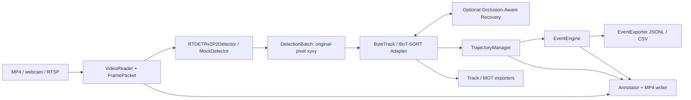

# Kiến trúc hệ thống

Thiết kế ban đầu Phase0, cập nhật trạng thái ngày23/10/2026. Detection/video đã
triển khai local; tracker/OAR/events/evaluation còn là thiết kế. Lộ trình có hiệu
lực ở [IMPLEMENTATION_PLAN](IMPLEMENTATION_PLAN.md): baseline evaluation trước
OAR, validation ablation trước trajectory/events, Đồ án3 ngoài phạm vi. Số phase
trong các mục kỹ thuật dưới đây là phân nhóm module của thiết kế ban đầu.

## 1. Luồng dữ liệu và ranh giới module

Một pipeline có một camera/session, clock đơn điệu và tracker state riêng.
Detector chỉ trả observation; tracker quản lý identity; recovery chỉ nhận
observation, state và lịch sử, không nhận GT. Evaluation là tiến trình offline
đọc prediction và GT sau inference. EventEngine không import model hoặc backend.

Package tên `traffic_mot`, không đặt package tên `src`: RT-DETR đã dùng `src.core`,
`src.data`, `src.zoo`. Bridge loader chỉ đăng ký một checkout RT-DETR trong một
process, xác minh nguồn import, không xóa `sys.modules` để đổi repo khi đang chạy.
Trong tương lai nhiều camera có thể chạy worker riêng; chưa triển khai worker pool.

## 2. Hợp đồng RT-DETRv2-P2 → tracker

Tài sản kiểm kê: `../../artifacts/E1_p2_final/{best.pth,demo_config.yml,label_map.json,classes.txt}`;
code `../../RT-DETR/rtdetrv2_pytorch` tại commit
`29320b6fd828f8e0987a71426cf2d961b09dfed7`. Đường dẫn cấu hình ở YAML, không nhúng
vào adapter. Tái sử dụng logic đã kiểm thử trong `rtdetrv2_next/demo.py` làm tài
liệu tham chiếu, không import giao diện web/Streamlit vào pipeline mới.

1. Nhận frame BGR `uint8[H,W,3]`, lưu kích thước gốc; chuyển RGB/PIL.
2. Dùng đúng validation Compose từ model config: stretch resize 640×640,
   float32 CHW và chia 255. Không letterbox, không ImageNet mean/std.
3. Khởi tạo `YAMLConfig`, tắt tải backbone pretrained, load `ema.module`
   với `strict=True`, `eval()` và `torch.inference_mode()`. Không tự fallback
   sang model weights nếu EMA yêu cầu nhưng thiếu; phải chọn profile tường minh.
4. Forward trả `pred_logits`, normalized `pred_boxes` dạng cxcywh. Postprocessor
   chính thức nhận `orig_target_sizes=[[W,H]]`; trả xyxy theo pixel frame gốc.
   Không scale box lần thứ hai. FP32 là chuẩn; AMP CUDA phải qua gate sai lệch.
5. Bỏ slot 0, xác thực mọi label còn lại, chỉ giữ ID phương tiện 3–10. Bảo toàn
   ID gốc trong metadata; có thể thêm index nội bộ nhưng phải có mapping hai chiều.
6. Giữ score ≥ 0.10 trước tracker. Detector cutoff cao hơn low threshold sẽ làm
   mất association giai đoạn hai. Loại NaN/Inf, clip vào ảnh, loại box rỗng;
   giữ float32 đầy đủ precision, chưa làm tròn. Không tự thêm NMS vào baseline.
7. `DetectionBatch` gồm boxes Nx4, scores N, class_ids N và detection_indices N;
   frame không detection vẫn có array đúng shape `(0,4)` và vẫn gọi tracker.

Các label được kiểm chứng từ bundle + classifier shape:

| Model ID | Tên | Theo dõi phương tiện |
|---|---|---|
| 0 | unused slot | bỏ |
| 1, 2 | pedestrian, people | bỏ trong profile phương tiện |
| 3, 4, 5, 6 | bicycle, car, van, truck | giữ |
| 7, 8, 9, 10 | tricycle, awning-tricycle, bus, motor | giữ |

Batch inference có thể thêm ở Phase 1: tensor B×3×640×640, B kích thước gốc,
postprocess riêng từng frame; từng camera vẫn update tracker tuần tự. Mặc định
batch 1 cho streaming, không gộp timestamp hoặc đảo thứ tự frame.

## 3. Backend tracking và baseline trung thực

Chọn implementation ByteTrack và BoT-SORT trong `ultralytics==8.4.171`, gọi trực
tiếp tracker class, không dùng `YOLO.track` hoặc thay detector. Backend cung cấp
Kalman, high/low association, birth, lost/removal; tránh viết lại thuật toán nền.
Đây là baseline **implementation Ultralytics**, không khẳng định bitwise giống
repository tác giả bài báo. Package khai báo AGPL-3.0; lưu license/source trong
artifact dependency trước khi phân phối hệ thống dựa trên backend này.

Bridge Phase 2 chuyển xyxy/scores/class_ids thành `ultralytics.engine.results.Boxes`
dạng Nx6 `[x1,y1,x2,y2,score,class_id]`, rồi `.numpy()` trước `tracker.update`.
Container này hỗ trợ `.xywh`, `.xyxy`, `.conf`, `.cls`, slicing và empty batch.
Với pin hiện tại, output thường Nx8 `[x1,y1,x2,y2,id,score,cls,det_index]`;
test contract phải xác minh cả empty output và detection index trước khi phụ thuộc.
Không truyền mảng Nx6 trực tiếp vào API yêu cầu thuộc tính `results.conf`.

E0/E1 giữ matching cost của backend, không chèn class gate hoặc recovery. Backend
mặc định association không khóa class; phải báo cáo lỗi đổi lớp và class-aware
metrics, không mô tả baseline thành per-class tracker. `match_thresh` là ngưỡng
cost tối đa, không phải IoU tối thiểu. `track_buffer=30` trong pin này là 30 frame;
adapter không tự đổi sang giây. Offline baseline stride 1. Clip sai FPS/timestamp
phải có protocol cụ thể, không lặng lẽ đổi lifecycle Kalman theo wall clock.

BoT-SORT E1 dùng GMC `sparseOptFlow`, `with_reid=false`. Ghi log số lần GMC thất bại
và identity fallback. Biến thể GMC off được báo cáo riêng nếu camera cố định.
ReID là nhánh tùy chọn sau này: cần extractor được kiểm chứng trên vehicle,
crop/normalization/embedding rõ ràng, checkpoint hash và overhead. Không dùng
`model=auto` với RT-DETR, không tải ngầm model phân loại khác làm ReID.

Adapter xuất trạng thái `tentative/tracked/lost/removed`, `observed` và last
observation riêng với Kalman estimate. MOT exporter chỉ nhận confirmed + observed;
lost predictions phục vụ history/diagnostic, không tạo detection hoặc event.
ID backend là nội bộ; public ID bất biến trong camera/session, không tái sử dụng.

## 4. Đề xuất Occlusion-Aware Track Recovery (OAR)

Mục tiêu nghiên cứu: tăng khả năng giữ ID sau che khuất ngắn mà kiểm soát nối nhầm.
Không đảm bảo ID dưới che khuất hoàn toàn, đối tượng giống nhau hoặc chuyển động
khó dự đoán. `suspected_occluded` là giả thuyết suy luận, khác annotation GT.

**Evidence:** theo lịch sử track đã xác nhận, tính IoA có hướng
`intersection(predicted_lost_box, observed_box)/area(predicted_lost_box)`.
Overlap ≥ 0.5 ở ít nhất 2/5 frame gần nhất là evidence khởi đầu; overlap không
chứng minh thứ tự chiều sâu. Box chạm dải biên 3% và velocity hướng ra ngoài
được gắn suspected_exit; không đủ evidence → unknown/detector_miss, không gọi là
occlusion thật. Ghi từng lý do và độ tin cậy cho phân tích lỗi.

**Retention:** chỉ kéo dài tuổi thọ track có evidence, từ 30 lên tối đa 90 frame
và không quá 3000 ms; ngắt khi exit rõ hoặc covariance quá lớn. Có giới hạn bộ
nhớ/candidate. Dùng prediction/covariance của Kalman backend và đúng hệ tọa độ
GMC hiện tại. Không dùng constant-velocity ad hoc thay cho Kalman khi báo cáo.

**Reassociation:** ưu tiên toàn bộ stock high/low matches trước. Chỉ track lost
eligible và detection high-score chưa matched mới được xét; không cướp observation
của track đang sống. Gate class, gap, Mahalanobis bình phương 4D ≤ 9.4877 và IoU
predicted ≥ 0.10; cost ban đầu `0.7*(1-IoU)+0.3*min(d²/gate,1)`.
Giải assignment một-một bằng solver chuẩn. Từ chối cặp nếu cost tốt nhất và ứng
viên cạnh tranh chênh dưới 0.15. Appearance chỉ thêm khi extractor thật đã qua gate.
Mọi con số là giả thuyết tune trên validation, không phải kết luận hiệu quả.

**Điểm chèn Phase 3:** subclass/backend hook có diff nhỏ, trước removal và trước
birth từ unmatched high detections, sau association gốc. Phải giữ invariant:
predict một lần/frame, update mỗi track tối đa một lần, dùng chung GMC transform,
không sinh ID mới rồi đổi ngược khi public record đã xuất. Nếu API pin không có
hook phù hợp, thực hiện extension có version và regression test; không monkeypatch
state âm thầm. E0/E1 chạy backend gốc; E2/E3 chạy extension được ghi riêng vào manifest.
Reactivation giữ public ID; mọi alias/local ID map phải được áp dụng trước export,
trajectory và EventEngine, và giữ vĩnh viễn tới cuối session.

## 5. Video, trajectory, event và vận hành

VideoReader quản lý capture/writer bằng context manager, xác thực nguồn và FPS,
release khi lỗi; file dùng PTS, live dùng monotonic session. MP4 output giữ
timeline rõ ràng; RTSP reconnect tạo session mới khi clock/source gián đoạn.
Pipeline offline tuần tự là chuẩn; future live queue phải ghi frame drop thay vì
âm thầm tăng FPS. Không log URL có credentials.

Trajectory lưu deque giới hạn 120 điểm observed; displacement/direction theo
pixel và timestamp. EMA smoothing chỉ ảnh hưởng trajectory hiển thị/analytics,
không làm lệch box MOT. Không nội suy qua gap dài để kích hoạt crossing/stop.

EventEngine dùng bottom-center, YAML normalized ROI/line, hysteresis và episode
state để chống đếm trùng. Line crossing kiểm tra giao đoạn hữu hạn, không chỉ
đổi dấu qua đường thẳng vô hạn. Stationary/wrong-way cần observation liên tục,
dwell time và reset khi gap quá dài. Vehicle count được dẫn xuất từ crossing
đã dedup. Chi tiết API/schema ở [INTEGRATION_SPEC](INTEGRATION_SPEC.md).

Lưu JSONL tăng dần, CSV flattened và MOT offline riêng. Output directory theo
run UUID, config resolved, hashes, Git dirty diff và môi trường. Không ghi đè
checkpoint/config train. Annotator bật/tắt từng lớp trong YAML, không cần GUI.

## 6. Nguồn kỹ thuật

- [RT-DETR tại commit đã kiểm kê](https://github.com/lyuwenyu/RT-DETR/tree/29320b6fd828f8e0987a71426cf2d961b09dfed7/rtdetrv2_pytorch).
- [ByteTrack implementation](https://github.com/ultralytics/ultralytics/blob/v8.4.171/ultralytics/trackers/byte_tracker.py),
  [BoT-SORT implementation](https://github.com/ultralytics/ultralytics/blob/v8.4.171/ultralytics/trackers/bot_sort.py).
  API được đối chiếu trực tiếp với source package 8.4.171 đã cài trên máy.
